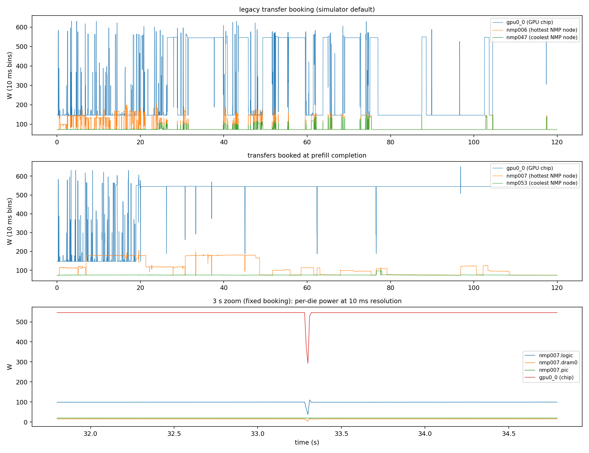
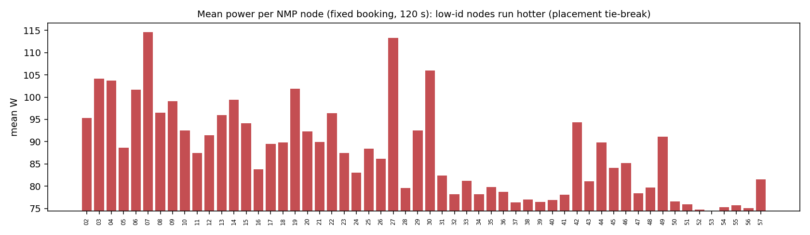
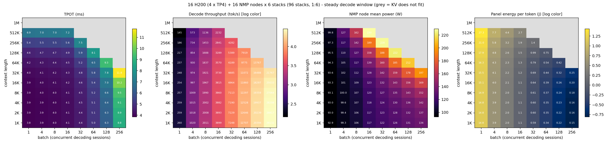
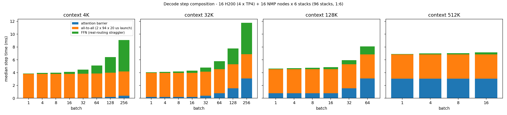
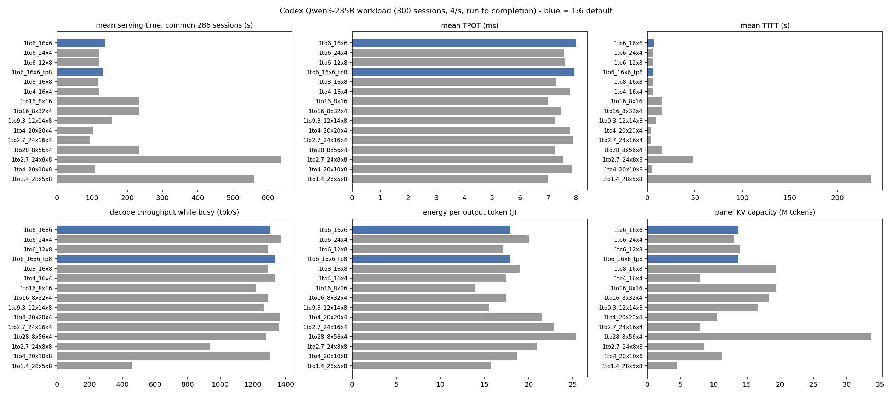
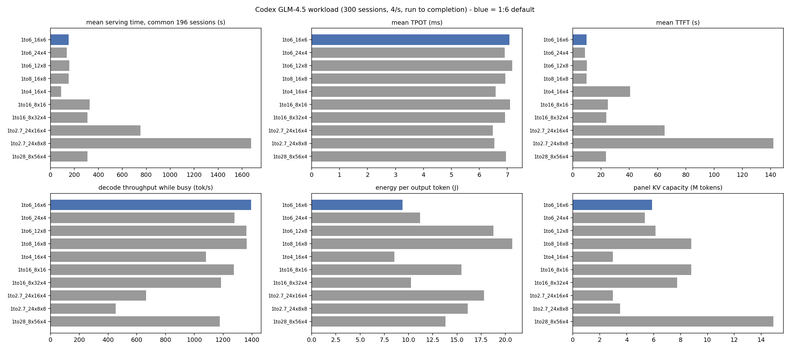

# Power traces for a GPU-prefill / NMP-decode glass panel: high-level takeaways

*2026-09-28. Qwen3-235B-A22B, TraceLab Codex agentic sessions, real MoE routing.
Companion documents: [power_model.md](power_model.md) (how the pipeline works),
[power_audit.md](power_audit.md) (what was checked, what was wrong, what was fixed).
Figures: `docs/figures/power_takeaways/`. Raw outputs: `results/power/` (local).*

## TL;DR

1. **Static power sets the temperature floor.** On the 8 H200 + 56-node panel under
   the Codex workload, static power is 5.2 kW of an 8.9 kW mean: 59% of energy.
   Only the photonic-chip heaters (Wang et al.) are sourced. The rest (logic leakage,
   DRAM background, optical-I/O drivers, GPU idle, HBM background) are placeholders
   and should be the first numbers the hardware owners replace.
2. **Wang et al.'s photonics numbers make each PIC a steady 18.9 W heater**, 6.3×
   the ~3 W PanAgretti assumed. That is 1.2 kW across 64 panel nodes, constant in
   time, and 35.4 W per node without substrate undercut. On a GPU chip, the PIC die
   also carries the 17.7 W driver chip, so it sits at 36.6 W.
3. **GPU prefill dominates dynamic power and transients.** An H200 xPU die jumps
   between 90 W and 488 W within one 10 ms bin (compute-bound prefill pins it at
   the TDP-derived ceiling). The Codex workload's rare giant prefills (up to 310K new
   tokens, 63 s of compute on a TP4 group) create minute-long plateaus. With 8 H200s
   the prefill pool is saturated: mean TTFT 12 s.
4. **NMP decode nodes are cool and slow-varying.** Node mean 87 W (74-115 W across
   nodes), peak 219 W; logic die 38-123 W, DRAM dies 4-19 W. Power changes on
   0.1-10 s scales as sessions are admitted, pause for tools and resume. The 8 ms
   decode steps average out inside a 10 ms bin.
5. **Where heat lands is set by session placement, not by expert routing.**
   Attention energy per node spans 0.02× to 3.0× the mean, because placement ties
   break to low device ids and cached sessions stay put. Real routing moves FFN
   energy (hot nodes 015/017/013/008 instead of 002-005, 1.45× max/mean), but FFN
   is only 14% of NMP dynamic energy.
6. **perf_sim's default NMP node is compute-bound on attention.** GQA-16 attention
   needs 16 FLOP/B; a perf_sim-default node supplies 4.2. Decode heat therefore sits
   on the logic die, not the DRAM dies, and one session's attention takes ~3× longer
   than on the paper's node.
7. **Decode TPOT has a 3.8 ms floor** set by the fixed all-to-all launch latency
   (2 × 94 layers × 20 µs), whatever the batch or context. Attention adds
   0.03-4.6 ms; FFN only matters at batch ≥ 128.
8. **KV capacity, not compute, bounds batch × context.** On the 1:6 panel (16 H200 +
   16 six-stack nodes), 128K contexts fit 64 sessions and 512K fit 16. 1M fits
   nowhere unless nodes have ≥ 8 stacks (or KV is FP8).
9. **For this Codex workload, prefill (GPU) capacity decides speed; decode TPOT is 7-8 ms in every split.**
   At the default 1:6 ratio, 8-stack nodes (12 × 8) are 1.14× faster than 6-stack nodes and serve every
   session. At ~iso-power, 20 H200 + 10 × 8-stack nodes (1:4) is 1.25× faster with no sessions dropped. More
   GPU-heavy splits are faster only by dropping the longest sessions, and then fall off a KV-capacity cliff
   (24 H200 + 8 × 8 stacks: 0.21×).
10. **GLM-4.5 runs through the same pipeline unchanged (§5), and its shape changes the
    answer.** Its KV is 1.96× Qwen's per token, so a 4-stack node holds 266K tokens
    instead of 602K: 32 of 300 Codex sessions are dropped and 405 turns cut, the hot
    nodes run hotter (up to 154 W mean), and 512K contexts fit on no studied node.
    Its 702 GB of FP16 weights force TP8 prefill, halving the prefill groups per GPU.
    No GLM routing traces exist, so its expert energy and FFN timing use the even split.
11. **The audit found one serious bug, now fixed for power runs.** The simulator
    booked prefill→decode KV transfers ahead of the clock, which stalled all decode
    for seconds (steps up to 22 s). The fix more than doubles decode throughput and
    reshapes the traces. The rest of the 61 findings are small, documented, or fixed;
    103 items were independently verified correct.

---

## 1. What was run

### 1.1 Hardware

| | GPU (prefill) | NMP node (decode) |
|---|---|---|
| Source | perf_sim `get_xpu_config('H100')` defaults, as H200 | perf_sim `DRAM3D/config.py` defaults (unpatched stack) |
| Compute | 980 TFLOPS dense FP16 per chip (derated 0.65 → 637 TFLOPS) | per stack: 16 ch × 16 banks × 16×16 MACs @ 1 GHz = 65,536 MACs; measured 69% (attention) / 59% (GEMM) efficiency |
| Memory | HBM3e 4.8 TB/s (derated 0.75 → 3.6 TB/s), 141 GB | per stack: 32 GiB, 8 tRCD tiers, 21.8 TB/s effective streaming (24.2 TB/s peak) |
| Power | TDP 600 W (perf_sim busy power); e_flop derived 0.625 pJ/FLOP; HBM 3.2 pJ/bit | 0.659 pJ/MAC + 0.0166 pJ/bit operand fill (fitted to perf_sim, ≤ 2.6% logic-die residual); DRAM 0.429 pJ/bit |
| Node | TP4 groups (Qwen3-235B FP16 = 470 GB) | S stacks per node; attention at S × stack (KV striped); FFN at perf_sim's TP = S rate (≈ half of S-fold scaling) |

Panels studied:
- **Paper split:** 8 H200 (2 × TP4) + 56 nodes × 4 stacks (224 stacks, 1:28).
- **User default 1:6:** 16 H200 (4 × TP4) + 16 nodes × 6 stacks (96 stacks).
- **Variants:** see §4.

### 1.2 How Wang et al. (CICC 2024) was applied

Table 1 gives *thermal-tuning* energy per bit, i.e. heater power divided by the
1.024 Tb/s link rate (64 channels × 16 Gb/s):

| Component (w/ undercut) | fJ/b | W per link | W per node (63 links) |
|---|---|---|---|
| Disk modulators (64) | 206 | 0.211 | 13.29 |
| Disk filters (64) | 59.6 | 0.061 | 3.85 |
| (De-)interleavers (9 × 3 heaters) | 28 | 0.029 | 1.81 |
| **On-panel PIC total** | **293.6** | **0.301** | **18.94** |
| Without undercut | 548 | 0.561 | 35.35 |
| Comb source (off-panel, excluded) | 19.6-40 | 0.020-0.041 | panel: 81-165 W total |

Four decisions, each confirmed by the audit:
- **Heater power is static.** Rings are held on resonance whether or not traffic flows.
- **The figure is per ring, not per bit.** At PanAgretti's 32 Gb/s channels the same heaters cost ~147 fJ/b.
- **×63 is correct.** The per-link figure already includes the Tx and Rx sides.
- **The comb is excluded.** It is off-panel in PanAgretti.

The paper reports no traffic-proportional (driver/receiver) energy. So optical I/O
is 100% static here and the `a2a` and `tp` categories are 0 J; the paper's own
"sub-pJ/b" target bounds any missing dynamic part at ~0.67 pJ/b. Heater power
falls as the PIC warms (~0.7 W/K per node), which a thermal loop should close.

### 1.3 Workload and pipeline

- **Workload.** TraceLab Codex segments (`configs/glassml/workload/sessions.json`, 54,869 segments). Per segment, medians: initial context 107K, 7 turns, 181 new prefill tokens per turn, 249 output tokens per turn, 1.1 s tool wait per turn. The tails are long: 0.3% of turns prefill more than 50K new tokens.
- **Main runs.** 300 sessions arriving at 4/s, seed 11, 120 s.
- **Routing.** Real Qwen3-235B decode routing (47,376 rows from 20 SWE-bench sessions) attributes FFN and all-to-all energy. Skew-aware FFN curves keep the simulator's timing consistent with it.
- **Checks passed.** The main trace run passes conservation, I/O balance, completeness (3.4M reservations), parity, stall and routing checks. Grid and split runs use the same pipeline and are not individually re-checked.

---

## 2. The panel trace (8 H200 + 56 × 4-stack NMP, Codex, 120 s)

### 2.1 Headline numbers

| | Legacy booking (simulator default) | **Transfers booked at completion (used)** |
|---|---|---|
| Decode throughput | 1,070 tok/s | **2,582 tok/s** |
| Mean inter-token time | 51.5 ms | **8.3 ms** |
| Longest decode step | 15.4 s | **0.067 s** |
| Mean / p95 TTFT | 1.1 / 5.0 s | **12.3 / 31.8 s** (prefill pool saturated) |
| Completed turns | 327 | 595 |
| Panel mean power | 6.98 kW | **8.87 kW** |
| Energy (120 s) | 837 kJ | **1,064 kJ** |

Energy split in the used run: static 627 kJ (59%), prefill 335 kJ (32%), decode
attention 88 kJ (8%), decode FFN 14 kJ (1.3%), KV/pool transfers 0.5 kJ,
optical I/O 0 J.

Legacy booking hid about 60% of the decode work and nearly half of the prefill load. The
difference is not a tuning choice but a simulator artifact (§6).



### 2.2 Per-die power (the numbers a 3D-ICE floorplan needs)

| Die | Static (W) | Mean across dies (W) | Hottest die mean (W) | p95 (W) | Peak (W) | Max 10 ms change (W) |
|---|---|---|---|---|---|---|
| GPU xpu | 90 | 437 | 443 | 488 | 488 | 397 |
| GPU hbm | 20 | 22 | 22 | 27 | 166 | 137 |
| GPU pic (+ EIC) | 36.6 | 36.6 | 36.6 | 36.6 | 36.6 | 0 |
| NMP logic | 38.0 | 44.8 | 60.8 | 105 | 123 | 85 |
| NMP DRAM (each of 4) | 3.86 | 5.7 | 8.7 | 15.9 | 19.3 | 15 |
| NMP pic | 18.9 | 18.9 | 18.9 | 18.9 | 18.9 | 0 |

- **GPU xpu die.** Pinned at its compute-bound ceiling, 488 W = TDP − HBM power at full bandwidth − HBM static. That happens whenever a prefill is compute-bound, which is most of the time once the pool saturates.
- **GPU package above TDP.** In 40 of 96,000 chip-bins the package (xpu + HBM) exceeds the 600 W TDP, reaching 621 W. There, KV transfers read HBM concurrently with prefill; HBM bandwidth sharing is not modelled.
- **NMP nodes.** They average 87.5 W; their dynamic part is small (logic +7 W and DRAM +1.8 W per die on average) but bursts to 3× static on the logic die.

### 2.3 Temporal behaviour

- **10 ms scale.** A node's power barely moves bin to bin (p99 |ΔP| 0.6 W), but GPU chips swing by up to 477 W.
- **Seconds to minutes.** The structure that matters is:
  - GPU plateaus from long prefills;
  - NMP nodes stepping up by 40-100 W when a long-context session is admitted, and back down when it leaves for a tool call.
- **Order of events.** Prefill (GPU) leads decode (NMP) by the TTFT. The panel does not heat uniformly.

### 2.4 Spatial behaviour



- **Attention energy per node spans 0.02× to 3.0× the mean.** The simulator's
  `least_active_context` placement breaks ties to the lowest device id, and
  cached sessions stay on their node across turns. The resulting spatial pattern
  follows placement policy, so it is a knob the thermal study can exploit.
- **Real routing vs equal split.**
  - Real routing puts FFN energy on nodes 015, 017, 013 and 008 (expert popularity; 1.45× max/mean, 0.69× min/mean). The equal split puts it on nodes 002-005, an artifact of the simulator's remainder rule.
  - Equal splitting also overstates FFN energy by 64% (23.2 vs 14.1 kJ), because it assumes every token hits a distinct expert.
  - Real routing also makes 98% of expert copies remote (EP56).

---

## 3. Batch × context sweep

Every cell in this section runs B sessions, each already at context C. Each
session prefills 128 new tokens and then decodes 256 tokens. The tables report the
steady window in which all B sessions decode together. "—" means the batch's KV
cannot be resident at once. Script: `scripts/power_sweep.py grid`; full JSON/CSV in
`results/power/grid_*`.



### 3.1 Default 1:6 panel: 16 H200 + 16 nodes × 6 stacks

**TPOT (ms)**

| context \ batch | 1 | 4 | 8 | 16 | 32 | 64 | 128 | 256 |
|---|---|---|---|---|---|---|---|---|
| 1K | 3.8 | 3.9 | 4.0 | 4.1 | 4.4 | 5.0 | 6.3 | 8.8 |
| 2K | 3.9 | 3.9 | 4.0 | 4.1 | 4.4 | 5.1 | 6.3 | 8.9 |
| 4K | 3.9 | 3.9 | 4.0 | 4.1 | 4.5 | 5.1 | 6.4 | 9.1 |
| 8K | 3.9 | 4.0 | 4.0 | 4.1 | 4.5 | 5.2 | 6.6 | 9.5 |
| 16K | 3.9 | 4.0 | 4.1 | 4.2 | 4.6 | 5.4 | 7.0 | 10.2 |
| 32K | 4.0 | 4.1 | 4.2 | 4.3 | 4.8 | 5.8 | 7.8 | 11.8 |
| 64K | 4.2 | 4.3 | 4.4 | 4.5 | 5.2 | 6.5 | 9.3 | — |
| 128K | 4.6 | 4.7 | 4.7 | 4.9 | 5.9 | 8.1 | — | — |
| 256K | 5.4 | 5.5 | 5.5 | 5.6 | 7.5 | — | — | — |
| 512K | 6.9 | 7.0 | 7.0 | 7.2 | — | — | — | — |
| 1M | — | — | — | — | — | — | — | — |

**Decode throughput (tok/s)**

| context \ batch | 1 | 4 | 8 | 16 | 32 | 64 | 128 | 256 |
|---|---|---|---|---|---|---|---|---|
| 1K | 260 | 1020 | 2011 | 3899 | 7248 | 12707 | 20394 | 29132 |
| 2K | 259 | 1018 | 2008 | 3893 | 7229 | 12646 | 20239 | 28817 |
| 4K | 259 | 1015 | 2002 | 3882 | 7190 | 12528 | 19937 | 28208 |
| 8K | 257 | 1009 | 1990 | 3860 | 7113 | 12297 | 19359 | 27064 |
| 16K | 254 | 997 | 1967 | 3815 | 6964 | 11860 | 18297 | 25033 |
| 32K | 248 | 974 | 1921 | 3730 | 6685 | 11072 | 16488 | 21767 |
| 64K | 237 | 930 | 1837 | 3570 | 6189 | 9775 | 13767 | — |
| 128K | 217 | 854 | 1688 | 3289 | 5389 | 7919 | — | — |
| 256K | 186 | 734 | 1453 | 2841 | 4282 | — | — | — |
| 512K | 145 | 573 | 1136 | 2232 | — | — | — | — |
| 1M | — | — | — | — | — | — | — | — |

**NMP node mean power in the decode window (W)**

| context \ batch | 1 | 4 | 8 | 16 | 32 | 64 | 128 | 256 |
|---|---|---|---|---|---|---|---|---|
| 1K | 93 | 99 | 106 | 117 | 122 | 126 | 131 | 134 |
| 2K | 93 | 99 | 106 | 117 | 123 | 128 | 132 | 137 |
| 4K | 93 | 100 | 107 | 118 | 124 | 130 | 136 | 142 |
| 8K | 93 | 100 | 107 | 120 | 127 | 135 | 143 | 152 |
| 16K | 93 | 101 | 109 | 123 | 132 | 143 | 156 | 169 |
| 32K | 94 | 102 | 112 | 128 | 142 | 159 | 178 | 197 |
| 64K | 94 | 105 | 117 | 139 | 160 | 185 | 212 | — |
| 128K | 95 | 110 | 127 | 158 | 188 | 222 | — | — |
| 256K | 97 | 117 | 142 | 189 | 228 | — | — | — |
| 512K | 100 | 127 | 162 | 230 | — | — | — | — |
| 1M | — | — | — | — | — | — | — | — |

**NMP logic die, mean (W)**

| context \ batch | 1 | 4 | 8 | 16 | 32 | 64 | 128 | 256 |
|---|---|---|---|---|---|---|---|---|
| 1K | 48 | 49 | 51 | 53 | 56 | 61 | 68 | 76 |
| 2K | 49 | 49 | 51 | 53 | 56 | 62 | 69 | 78 |
| 4K | 49 | 50 | 51 | 53 | 57 | 63 | 72 | 81 |
| 8K | 49 | 50 | 51 | 54 | 59 | 66 | 76 | 87 |
| 16K | 49 | 50 | 52 | 56 | 63 | 72 | 84 | 97 |
| 32K | 49 | 51 | 54 | 60 | 69 | 82 | 98 | 114 |
| 64K | 49 | 53 | 58 | 67 | 81 | 99 | 119 | — |
| 128K | 50 | 56 | 64 | 80 | 99 | 123 | — | — |
| 256K | 52 | 62 | 75 | 100 | 125 | — | — | — |
| 512K | 53 | 68 | 88 | 127 | — | — | — | — |
| 1M | — | — | — | — | — | — | — | — |

**Panel energy per output token (J)**

| context \ batch | 1 | 4 | 8 | 16 | 32 | 64 | 128 | 256 |
|---|---|---|---|---|---|---|---|---|
| 1K | 14.75 | 3.86 | 2.01 | 1.08 | 0.59 | 0.34 | 0.22 | 0.15 |
| 2K | 14.78 | 3.87 | 2.02 | 1.08 | 0.60 | 0.35 | 0.22 | 0.16 |
| 4K | 14.83 | 3.88 | 2.02 | 1.09 | 0.60 | 0.35 | 0.23 | 0.16 |
| 8K | 14.92 | 3.91 | 2.04 | 1.10 | 0.61 | 0.37 | 0.24 | 0.18 |
| 16K | 15.12 | 3.97 | 2.08 | 1.13 | 0.64 | 0.39 | 0.26 | 0.20 |
| 32K | 15.51 | 4.09 | 2.15 | 1.18 | 0.69 | 0.44 | 0.32 | 0.25 |
| 64K | 16.29 | 4.33 | 2.30 | 1.28 | 0.79 | 0.54 | 0.42 | — |
| 128K | 17.86 | 4.80 | 2.59 | 1.48 | 0.99 | 0.75 | — | — |
| 256K | 20.99 | 5.75 | 3.18 | 1.89 | 1.40 | — | — | — |
| 512K | 27.25 | 7.65 | 4.35 | 2.70 | — | — | — | — |
| 1M | — | — | — | — | — | — | — | — |

**Mean TTFT (s)**

| context \ batch | 1 | 4 | 8 | 16 | 32 | 64 | 128 | 256 |
|---|---|---|---|---|---|---|---|---|
| 1K | 0.04 | 0.04 | 0.04 | 0.04 | 0.04 | 0.05 | 0.09 | 0.17 |
| 2K | 0.04 | 0.04 | 0.04 | 0.04 | 0.04 | 0.05 | 0.10 | 0.18 |
| 4K | 0.04 | 0.04 | 0.04 | 0.04 | 0.05 | 0.06 | 0.11 | 0.21 |
| 8K | 0.04 | 0.04 | 0.04 | 0.05 | 0.05 | 0.08 | 0.15 | 0.28 |
| 16K | 0.04 | 0.04 | 0.05 | 0.05 | 0.06 | 0.11 | 0.21 | 0.40 |
| 32K | 0.04 | 0.05 | 0.05 | 0.06 | 0.09 | 0.17 | 0.33 | 0.66 |
| 64K | 0.04 | 0.05 | 0.06 | 0.08 | 0.15 | 0.30 | 0.59 | — |
| 128K | 0.04 | 0.06 | 0.08 | 0.15 | 0.28 | 0.55 | — | — |
| 256K | 0.06 | 0.08 | 0.14 | 0.27 | 0.54 | — | — | — |
| 512K | 0.11 | 0.14 | 0.27 | 0.53 | — | — | — | — |
| 1M | — | — | — | — | — | — | — | — |

### 3.2 What the grid says

- **Latency floor.** TPOT ≥ 3.76 ms at any batch or context: 188 all-to-all launches of 20 µs. At B = 1 the all-to-all is 97% of the step. Halving launch latency, or fusing layers' dispatches, is worth more than any compute change for interactive decode.
- **Step composition.**

  

  - Attention barrier: grows with sessions × context per node and saturates at about 3.1 ms, where a full node holds 854K tokens.
  - FFN: grows with batch. Under perf_sim's TP-across-stacks convention it reaches 4.9 ms (42% of the step) at B = 256, 32K.
- **Throughput.**
  - At 1K context it scales almost linearly to 29K tok/s at B = 256.
  - At 128K it peaks at 7.9K tok/s (B = 64, capacity-bound).
  - At 512K it tops out at 2.2K tok/s (B = 16, one session per node).
- **NMP power range for thermal.**
  - Node mean power runs from 93 W (idle-ish) to 230 W (every node full: B = 16 at 512K).
  - Logic die: 48 → 128 W. DRAM die: 4.3 → 14 W. PIC: 18.9 W flat.
  - Heat concentrates on the logic die because perf_sim-default attention is compute-bound.
- **Energy per token.**
  - 14.8 J/token at B = 1, of which static is 99%.
  - Below 0.3 J/token at B ≥ 128 for short contexts.
  - Long contexts cost more: 2.7 J/token at 512K × 16, where attention alone is 1 J/token of NMP dynamic energy.
- **TTFT in the grid is small** (≤ 0.7 s), because contexts load from the pool and only 128 tokens are computed. The Codex workload's TTFT problem comes from its giant prefills, not from this regime.

### 3.3 1M context and node size

On a 6-stack node, KV capacity is 854K tokens, so no 1M cell fits. With 8-stack
nodes (same 96 stacks as 12 × 8), capacity is 1.16M tokens per node:

| 1M context, 16 H200 + 12 × 8 stacks | B = 1 | B = 4 | B = 8 |
|---|---|---|---|
| TPOT (ms) | 8.5 | 8.5 | 8.6 |
| Decode tok/s | 118 | 468 | 929 |
| Hottest NMP node, mean in window (W) | 326 | 327 | 327 |

B ≥ 16 at 1M does not fit on any studied panel (each session needs its own node).
FP8 KV would halve the footprint.

The paper split (56 × 4-stack nodes, 224 stacks) is ~20% slower per session at long
context (512K, B = 1: 8.4 vs 6.9 ms TPOT), because each session's attention runs on
4 stacks instead of 6. It is faster at large batch (33K vs 29K tok/s at 1K × 256),
because it has 2.3× the stacks. Its nodes run cooler: 73-139 W per node, logic die
38-76 W.

---

## 4. Configuration splits on the Codex workload

Script: `scripts/power_sweep.py splits`.

- **Workload.** 300 Codex sessions arriving at 4/s, run to completion. Timing uses equal routing: routing never changes timing, and it only moves ~1% of energy between nodes.
- **Baseline.** 16 H200 + 16 × 6-stack nodes (1 GPU : 6 stacks).
- **Power budget.** Rated power is 600 W per H200 plus 144.5 W per stack, perf_sim's Stratum-L assumptions; ~23.5 kW for the 1:6 panel.
- **Primary metric: per-session serving time**, i.e. session latency minus its tool waits (the part the hardware controls).
- **Common session set.** Configurations with small nodes cannot hold the longest sessions, so they are truncated to fit. Speedups are therefore computed on the 286 sessions that every non-stalled configuration served in full (a run that ends with sessions stuck is shown but excluded from the set).

Common set: 286 sessions completed in full by every config.

| config | GPUs : stacks (nodes x stacks, TP) | rated kW | panel KV (M tok) | dropped / cut turns | serving s, common set (speedup) | serving s, all completed | TPOT ms | TTFT s mean (p95) | prefill queue s | busy decode tok/s | panel mean kW | J/token |
|---|---|---|---|---|---|---|---|---|---|---|---|---|
| 1to6_16x6 | 16 : 96 (16x6, TP4) | 23.5 | 13.7 | 3 / 35 | 135.9 (1.00x) | 136.3 | 8.0 | 6.7 (30) | 2.3 | 1304 | 4.11 | 17.9 |
| 1to6_24x4 | 16 : 96 (24x4, TP4) | 23.5 | 13.1 | 13 / 161 | 119.5 (1.14x) | 119.2 | 7.6 | 5.6 (28) | 2.3 | 1370 | 4.38 | 20.0 |
| 1to6_12x8 | 16 : 96 (12x8, TP4) | 23.5 | 13.9 | 0 / 0 | 119.0 (1.14x) | 119.3 | 7.6 | 5.5 (26) | 2.2 | 1292 | 3.97 | 17.1 |
| 1to6_16x6_tp8 | 16 : 96 (16x6, TP8) | 23.5 | 13.7 | 3 / 35 | 129.9 (1.05x) | 130.2 | 7.9 | 6.2 (27) | 2.1 | 1336 | 4.11 | 17.9 |
| 1to8_16x8 | 16 : 128 (16x8, TP4) | 28.1 | 19.4 | 0 / 0 | 117.8 (1.15x) | 118.1 | 7.3 | 5.6 (26) | 2.2 | 1289 | 4.40 | 19.0 |
| 1to4_16x4 | 16 : 64 (16x4, TP4) | 18.8 | 7.9 | 14 / 163 | 119.7 (1.13x) | 119.7 | 7.8 | 5.5 (25) | 2.1 | 1337 | 3.80 | 17.4 |
| 1to16_8x16 | 8 : 128 (16x8, TP4) | 23.3 | 19.4 | 0 / 0 | 233.0 (0.58x) | 231.6 | 7.0 | 15.1 (64) | 6.3 | 1219 | 3.23 | 14.0 |
| 1to16_8x32x4 | 8 : 128 (32x4, TP4) | 23.3 | 18.3 | 12 / 159 | 233.9 (0.58x) | 232.9 | 7.5 | 15.0 (59) | 6.2 | 1293 | 3.79 | 17.4 |
| 1to9.3_12x14x8 | 12 : 112 (14x8, TP4) | 23.4 | 16.7 | 0 / 0 | 155.6 (0.87x) | 155.0 | 7.2 | 8.6 (40) | 3.5 | 1265 | 3.60 | 15.5 |
| 1to4_20x20x4 | 20 : 80 (20x4, TP4) | 23.6 | 10.5 | 14 / 163 | 102.8 (1.32x) | 102.8 | 7.8 | 4.1 (21) | 1.6 | 1366 | 4.68 | 21.5 |
| 1to2.7_24x16x4 | 24 : 64 (16x4, TP4) | 23.6 | 7.9 | 14 / 163 | 94.8 (1.43x) | 94.8 | 7.9 | 3.4 (18) | 1.3 | 1358 | 4.97 | 22.8 |
| 1to28_8x56x4 | 8 : 224 (56x4, TP4) | 37.2 | 33.7 | 12 / 159 | 233.3 (0.58x) | 232.3 | 7.2 | 15.1 (59) | 6.2 | 1281 | 5.53 | 25.4 |
| 1to2.7_24x8x8 | 24 : 64 (8x8, TP4) | 23.6 | 8.5 | 0 / 0 | 636.4 (0.21x) | 631.7 | 7.5 | 47.6 (292) | 0.6 | 934 | 4.70 | 20.9 |
| 1to4_20x10x8 | 20 : 80 (10x8, TP4) | 23.6 | 11.2 | 0 / 0 | 108.8 (1.25x) | 108.5 | 7.8 | 4.5 (25) | 1.7 | 1302 | 4.34 | 18.7 |
| 1to1.4_28x5x8 (stalled) | 28 : 40 (5x8, TP4) | 22.6 | 4.4 | 2 / 6 | 559.9 (0.24x) | 570.2 | 7.0 | 235.8 (391) | 0.2 | 462 | 5.30 | 15.7 |



### 4.1 What the split study says

- **Prefill capacity is the bottleneck for this workload, not decode.**
  - TPOT is 7.0-8.0 ms in every configuration: the all-to-all floor plus a little attention.
  - Serving time follows TTFT, which follows the number of prefill groups: 8 GPUs 233 s, 12 GPUs 156 s, 16 GPUs 118-136 s, 20 GPUs 103-109 s, 24 GPUs 95 s (common set).
  - The Codex workload's rare giant prefills (up to 310K new tokens) occupy a TP4 group for tens of seconds; more groups mean less queueing behind them.
- **At the same hardware, 1:6 with 8-stack nodes beats 1:6 with 6-stack nodes.**
  - 16 H200 + 12 × 8 stacks is 1.14× faster than the default: 119 vs 136 s serving, TTFT 5.5 vs 6.7 s.
  - It serves every session (1.16M tokens per node), where the default drops 3 sessions and cuts 35 turns.
  - It also uses 3% less energy.
  - The default's 6-stack nodes (854K tokens) run into 531 KV-capacity retries with strict FCFS admission.
- **Shifting the iso-power budget toward GPUs helps, until KV capacity runs out.**
  - 20 H200 + 10 × 8 stacks (1:4) is 1.25× faster and still serves every session.
  - 20 H200 + 20 × 4 (1.32×) and 24 H200 + 16 × 4 (1.43×) are faster still. Their 4-stack nodes (~500K tokens) cannot serve the ~5% of sessions whose context exceeds that, so the speedup partly comes from not serving them.
  - The cliff is sharp. With 24 H200, only 64 stacks remain. As 8 × 8-stack nodes (8.5M tokens) they collapse: 0.21×, capacity wait 46 s per turn. 28 H200 + 5 × 8 stacks starves completely: capacity waits of 209 s, and only 137 sessions completed before admission stalled.
- **Other levers barely matter here.**
  - More decode stacks at 16 GPUs (16 × 8, +4.6 kW): 1.15×.
  - Fewer stacks (16 × 4, -4.6 kW): 1.13×, but drops long sessions.
  - TP8 prefill groups instead of TP4: 1.05×.
  - The paper's 8 H200 + 224 stacks (37 kW): 0.58×, because it has half the prefill groups (2 vs 4).
- **Recommendation for this workload.**
  - Keep the 1:6 hardware but build 8-stack nodes (12 × 8).
  - Better, move toward 1:4 at the same power: 20 H200 + 80 stacks as 10 × 8-stack nodes, 1.25× faster with no sessions dropped.
  - Going beyond ~1:3 trades the ability to hold long agent contexts for prefill speed, and falls off a KV-capacity cliff under FCFS admission.
- **Power and energy.**
  - Panel mean power is 3.2-5.5 kW over a run whose makespan (~8,900 s) is set by the slowest session's tool waits.
  - Energy per token (14-25 J) is therefore dominated by static power × idle time. It favours fewer GPUs, the opposite of speed.
  - For thermal design, the GPU-heavy configurations raise panel static power by ~0.15 kW per extra H200.

---

## 5. A second model: GLM-4.5

GLM-4.5 (355B-A32B) was run through the same pipeline: 92 layers (3 dense + 89 MoE),
160 routed experts top-8 plus one shared expert, hidden 5120, GQA 96/8. Nothing in
the power model is Qwen-specific; `scripts/power_sweep.py --model glm-4.5` builds the
panels. Two consequences of the model shape drive everything below:

| | Qwen3-235B | GLM-4.5 | Ratio |
|---|---|---|---|
| KV cache per token (FP16) | 192,512 B | 376,832 B | 1.96× |
| FP16 weights | 468 GB | 702 GB | 1.50× → prefill needs **TP8** (TP4 for Qwen) |
| Prefill FLOPs per token | 4.18e10 | 6.40e10 | 1.53× |
| Attention FLOPs per (query, key) pair | 3.08e6 | 4.52e6 | 1.47× |
| Resident weights per decode node (56 nodes) | 21.5 GB | 37.2 GB | |
| KV capacity per node, 4 / 6 / 8 stacks (K tokens) | 602 / 854 / 1,162 | 266 / 368 / 513 | 0.44× |

No GLM routing traces exist (`moe_routing` has Qwen only), so GLM uses the even expert
split for both energy attribution and FFN timing.

### 5.1 Panel trace (8 H200 as 1 × TP8 + 56 × 4-stack NMP, Codex, 120 s)

| | Qwen3-235B | GLM-4.5 |
|---|---|---|
| Sessions dropped / turns cut to fit node KV | 12 / 159 | **32 / 405** |
| Decode throughput, inter-token time | 2,582 tok/s, 8.3 ms | 2,194 tok/s, 6.9 ms |
| Mean / p95 TTFT (one TP8 group vs two TP4 groups) | 12.3 / 31.8 s | 17.3 / 40.3 s |
| Panel mean power | 8.87 kW | 9.17 kW |
| Energy: static / prefill / attention / FFN | 627 / 335 / 88 / 14 kJ (FFN 23 kJ with the even split) | 627 / 343 / 103 / 27 kJ |
| GPU xpu die mean, peak | 437 W, 488 W | 445 W, 488 W |
| NMP node mean (min–max over nodes), peak | 87 W (74–115), 219 W | 90 W (76–154), 222 W |
| NMP logic die mean (hottest node), peak | 45 W (61), 123 W | 45 W (75), 111 W |
| NMP DRAM die mean (hottest), peak | 5.7 W (8.7), 19 W | 6.4 W (15), 23 W |
| Attention energy per node, min–max / mean | 0.02× – 3.0× | 0.11× – 4.9× |
| FFN share of NMP dynamic energy (even split in both) | 21% | 21% |

Reading: GLM's larger KV halves what a 4-stack node can hold, so more of the Codex
sessions (which start at a median 107K context) are truncated, fewer sessions share a
node, and the hot nodes get hotter (154 W mean on the hottest node vs 115 W).
Like-for-like (Qwen with the same even split), GLM's FFN energy is 1.17× Qwen's
(27 vs 23 kJ) at the same 21% share of NMP dynamic energy; the 14 kJ Qwen figure comes
from real routing, which reuses hot experts. The single TP8 prefill group forms very
large batches (up to 98 requests, 24 s of compute), so one batch is still running at
t = 120 s and 11% of the run's energy falls past the horizon. All checks pass
(conservation, I/O balance, completeness, parity, no stalls; longest step 0.2 s).

### 5.2 Batch × context, default 1:6 panel (16 H200 as 2 × TP8 + 16 × 6 stacks)

62 of 88 cells fit (70 for Qwen). The 6-stack node holds 368K GLM tokens, so 512K and
1M contexts fit nowhere; even 8-stack nodes (513K) cannot hold a 512K session plus
its new tokens. Envelopes over the feasible cells:

| | Qwen3-235B (shipped grid, skew-aware FFN) | Qwen3-235B, balanced FFN (like-for-like) | GLM-4.5 (balanced FFN) |
|---|---|---|---|
| TPOT floor (batch 1, short context) | 3.8 ms | 4.1 ms | 4.1 ms |
| Largest feasible cell | 512K × 16 | 512K × 16 | 256K × 16 |
| TPOT at 1K × 256 | 8.8 ms | 6.3 ms | 7.2 ms |
| Throughput at 1K × 256 | 29.1K tok/s | 40.7K tok/s | 35.5K tok/s |
| NMP node mean power | 93 – 230 W | — | 94 – 248 W |
| NMP logic die mean | 48 – 128 W | — | 49 – 129 W |
| NMP DRAM die mean | 4.3 – 14 W | — | 4.4 – 18.5 W |
| Energy per token at batch 1 | 14.8 J | — | 15.9 J |

Like-for-like, GLM's FFN barrier is 1.3–1.7× Qwen's (more FLOPs per token, 1.37×,
and the even split's remainder rule), so GLM decodes ~13% slower at 1K × 256, not
faster: the shipped Qwen grid is slower there only because its skew-aware curve
carries the real-routing straggler that the balanced curve omits.

The paper split (8 H200 as 1 × TP8 + 56 × 4) stays cooler per node, 73–165 W,
logic 38–85 W, as for Qwen.

### 5.3 Splits on the Codex workload

Same workload and method as §4 (300 Codex sessions at 4/s, run to completion, even
expert split in both models). TP8 groups mean the 12-, 20- and 28-GPU splits are not
valid for GLM and were skipped; the TP8 variant of 16 × 6 duplicates the baseline.
Speedups are on the sessions every non-stalled configuration served in full.

Common set: 196 sessions completed in full by every config.

| config | GPUs : stacks (nodes x stacks, TP) | rated kW | panel KV (M tok) | dropped / cut turns | serving s, common set (speedup) | serving s, all completed | TPOT ms | TTFT s mean (p95) | prefill queue s | busy decode tok/s | panel mean kW | J/token |
|---|---|---|---|---|---|---|---|---|---|---|---|---|
| 1to6_16x6 | 16 : 96 (16x6, TP8) | 23.5 | 5.9 | 20 / 277 | 152.6 (1.00x) | 165.4 | 7.1 | 9.8 (39) | 3.8 | 1394 | 4.82 | 9.4 |
| 1to6_24x4 | 16 : 96 (24x4, TP8) | 23.5 | 5.4 | 41 / 667 | 136.0 (1.12x) | 141.7 | 6.9 | 8.6 (33) | 2.7 | 1279 | 4.92 | 11.2 |
| 1to6_12x8 | 16 : 96 (12x8, TP8) | 23.5 | 6.2 | 14 / 163 | 157.8 (0.97x) | 171.3 | 7.2 | 10.0 (37) | 3.8 | 1361 | 4.09 | 18.8 |
| 1to8_16x8 | 16 : 128 (16x8, TP8) | 28.1 | 8.8 | 13 / 161 | 150.8 (1.01x) | 164.5 | 6.9 | 9.7 (39) | 3.9 | 1364 | 4.53 | 20.7 |
| 1to4_16x4 (stalled) | 16 : 64 (16x4, TP8) | 18.8 | 3.0 | 69 / 1035 | 90.4 (1.69x) | 90.5 | 6.6 | 40.5 (193) | 3.3 | 1081 | 4.72 | 8.5 |
| 1to16_8x16 | 8 : 128 (16x8, TP8) | 23.3 | 8.8 | 13 / 161 | 326.3 (0.47x) | 350.0 | 7.1 | 24.8 (93) | 9.7 | 1274 | 3.35 | 15.5 |
| 1to16_8x32x4 | 8 : 128 (32x4, TP8) | 23.3 | 7.7 | 34 / 487 | 307.9 (0.50x) | 325.5 | 6.9 | 23.7 (92) | 10.0 | 1186 | 4.37 | 10.3 |
| 1to2.7_24x16x4 | 24 : 64 (16x4, TP8) | 23.6 | 3.0 | 69 / 1035 | 750.9 (0.20x) | 774.0 | 6.5 | 64.9 (252) | 0.3 | 665 | 5.18 | 17.8 |
| 1to2.7_24x8x8 | 24 : 64 (8x8, TP8) | 23.6 | 3.5 | 17 / 196 | 1675.8 (0.09x) | 1779.3 | 6.5 | 141.9 (355) | 0.2 | 454 | 5.03 | 16.1 |
| 1to28_8x56x4 | 8 : 224 (56x4, TP8) | 37.2 | 14.9 | 32 / 405 | 309.7 (0.49x) | 330.0 | 7.0 | 23.5 (89) | 9.9 | 1176 | 6.14 | 13.8 |



What differs from Qwen:

- **KV capacity dominates.** Every 4-stack configuration drops 32–69 of the 300
  sessions and cuts hundreds of turns; even 6-stack nodes drop 20. Only 8-stack
  nodes (513K tokens) keep the drop near the Qwen level (13–17).
- **The 1:6 default is at its limit.** 16 × 6 serves 280 sessions with 976
  capacity retries. At the same stacks, 24 × 4 is 1.12× faster but drops 41 sessions;
  12 × 8 is 0.97× and drops 14. Adding stacks (16 × 8, 1:8, +4.6 kW) buys only 1.01×.
- **Fewer prefill groups hurt as before.** 8 H200 is one TP8 group: 0.47–0.50×.
- **GPU-heavy splits collapse earlier than for Qwen.** 24 H200 leaves 64 stacks,
  i.e. 3.0–3.5M tokens of panel KV for a workload whose sessions start at a median
  107K: 0.20× (16 × 4) and 0.09× (8 × 8, 141 s capacity waits per turn).
- **One run stalled.** 16 H200 + 16 × 4 ended with 97 sessions stuck waiting for
  KV (186K-token nodes); its row is marked and its speedup is not meaningful. This is
  the open admission-stall mode noted in §8.
- **Energy per token is not comparable across rows** (9–21 J): it is static power ×
  makespan ÷ tokens, and the makespan depends on which long-tool-wait sessions
  survived the capacity fit.

For GLM-4.5 on this panel family the practical answer is 8-stack nodes (or FP8 KV),
and a GPU:stack ratio no leaner than about 1:6; the lever that helped Qwen (more GPUs
at iso-power) runs out of KV first.

### 5.4 GLM-specific caveats

- **Even expert split only.** FFN energy lands on nodes by the simulator's
  deterministic assignment (160 experts over 56 nodes gives 2 or 3 per node, so
  the max/mean FFN energy per node is 1.9× from placement alone), and the FFN
  timing is the balanced roofline curve. For Qwen that curve was 2.3× too slow at
  batch 1 and 3.4× too fast at batch 4096 against real routing; expect the same bias
  here. Large-batch GLM throughput is therefore optimistic.
- **TP8 prefill.** FP16 weights need 8 H200s per group, so every GLM configuration
  has half the prefill groups of the Qwen one with the same GPU count. FP8 weights
  would restore TP4; the energy model would then need FP8 coefficients.
- **Coefficients.** The NMP MAC/operand-fill fit was made on Qwen's kernel shapes
  (hidden 4096); per-MAC energy does not depend on the shape to first order. The
  node attention rate was measured at GQA 16 (GLM is GQA 12); attention is
  compute-bound on perf_sim nodes either way.
- **Dense and shared-expert weights are EP-sharded, by inherited convention.** The
  roofline estimator (and so the FFN curves, node capacity and FFN energy) charges
  each node 1/EP of the 3 dense layers and the shared expert, with no collective.
  A real DP-attention deployment replicates them per node (5.3 GB), like the
  attention projections. Qwen has neither, so this never mattered before. For GLM it
  overstates node KV capacity by ~5% (266K → ~252K tokens on 4 stacks) and
  understates per-node FFN weight traffic (about +42% DRAM reads, ~60 µs more per
  step, ~7% NMP dynamic power at batch 64). Panel energy per token moves ≤ 3%. The
  capacity effect bites at the margin: on the 56 × 4 panel, 266K is only 1.3% above
  two 131K sessions, so under replication the 256K-context row and the 128K × 64
  cell of the §5.2 paper-split grid would not fit. Left as is because it is
  PanAgretti's estimator convention; changing it is a one-line decision in
  `roofline_model/estimator.py` if the replicated layout is intended.
- **All-to-all launch latency counts 92 layers, energy counts 89.** The generator
  multiplies the 20 µs dispatch cost by `num_layers`; the three dense layers have
  no expert dispatch. GLM TPOT is ~2–3% high at small batch (0.12 ms).
- **Grid comparability.** The shipped Qwen grids use skew-aware FFN curves (from
  real routing); the GLM grids use balanced curves with the even split. Against the
  skew-aware reference, the balanced curve is slower at batch ≤ 8 (0.1–0.25 ms, 3–6%
  of TPOT, biased *against* GLM) and faster from batch 32 up, growing to 21–31% of
  TPOT at batch 256 (biased *in GLM's favour*). The §5.2 table therefore shows a
  Qwen-balanced column; FFN energy is likewise only comparable against the Qwen
  even-split run. The split study and the §5.1 energy rows are like-for-like (both
  even split).
- **Ignored model details:** partial RoPE, the MTP layer, and attention output
  gating (small FLOP/byte terms).

---

## 6. Implementation check: what was right, what was wrong

Full detail: [power_audit.md](power_audit.md).

**Right (independently verified, 103 items).**
- Model math: every Qwen3-235B coefficient recomputed from the published config; prefill/decode/FFN counters vs the estimator; the simulator's prefill latency is bit-identical to the energy model over 20,000 random batches.
- Energy accounting: hand-computed decode attention, FFN (equal and real routing), prefill and transfer energies match the collector with zero relative error; conservation to 1e-8; no double counting.
- Routing: decode rows are exactly the generated tokens; the skew-aware FFN curves reproduce real straggler time at every batch up to 4096 for the EP56 placement.
- The Wang et al. mapping: static, per ring, ×63, comb excluded; 18.94 W.
- perf_sim default geometry and energy fit.
- Default simulator behaviour unchanged wherever the old code could run.

**Wrong, and fixed.**

| Problem | Effect | Fix |
|---|---|---|
| KV P2P transfers booked ahead of the clock stalled lock-step decode (pre-existing) | Steps up to 22 s; NMP idle 60-80% of the run; decode throughput ~2.4× low; GPU prefill load ~40% low | `prefill_transfers_at_completion` (on in all power runs): book at prefill completion and send via the copy engine |
| FCFS admission could deadlock with LRU caching (pre-existing) | 1:6 panel stopped at 732 s with 249 sessions stuck | Deadlock-only release of protected clean copies; FCFS order unchanged |
| NMP node FFN assumed perfect scaling over stacks | FFN time 1.3-2× short | Node rates measured in perf_sim at TP = stacks |
| NaN last bin for some horizons | Broken trace rows | Robust bin count |
| Anchors "ok" was a tautology for these presets | False confidence | `ok = null` when no independent anchor |
| Leakage placeholder scaled from the paper's larger die | +14 W per node | 10% of this die (20.3 W) |
| Stale docs, skew tail extrapolation, stall check blind spots | Misleading docs; latent errors | Fixed |

**Remaining known limits (documented).**
- Static power is mostly placeholder.
- Prefill latency assumes full compute/memory overlap (chip peak ~12% high) and uniform expert coverage.
- Attention time is linear in context (short contexts run fast).
- HBM bandwidth is not shared between prefill and transfers (package ≤ 621 W).
- Driver-chip placement differs by die kind; H200 TFLOPS/TDP come from perf_sim's H100 entry (if the part is an SXM, xPU heat is ~17% low).
- Heater power is temperature-independent.
- Routing traces come from batch-1 capture.

---

## 7. What to hand to the thermal model

- **Use** `results/power/h200_perf_sim_traces/power.npz`, or rerun `scripts/power_trace.py` for longer horizons. `power_w[t, die]` holds 10 ms bins for 361 dies (8 GPU chips × 3 dies, 56 NMP nodes × 6 dies, plus the KV pool).
- **Floorplan per die kind:**
  - GPU: `xpu` (compute), `hbm` (all HBM energy), `pic` (heaters + driver chip).
  - NMP: `dram0..3` (split evenly), `logic` (MACs, operand fill, SRAM, drivers, leakage), `pic` (heaters).
- **Time constants.** GPU dies step by ~400 W within 10 ms. NMP nodes step by 40-100 W on second scales. PIC dies are constant. A 10 ms bin resolves every modelled transient; 100 ms loses the GPU edges.
- **Sensitivities to run first.**
  1. Static placeholders (±50%).
  2. PIC without undercut (35.4 W).
  3. H200 SXM (700 W).
  4. Placement policy (spreads the hot low-id corner).
  5. A heater-power temperature coefficient (~0.7 W/K per node) once 3D-ICE gives die temperatures.

## 8. Next steps

- Replace placeholders with owner-supplied leakage/background power, and measure driver-chip power per bit.
- Model HBM bandwidth sharing, and use an affine attention model.
- Replace uniform prefill expert coverage with real prefill routing.
- Investigate the remaining admission stall on KV-starved panels (28 H200 + 5 × 8 stacks completed 137 of
  298 sessions); a smarter admission policy than strict FCFS would also soften the KV-capacity cliff.
- Try a load-balanced (non-id-ordered) attention placement and a lower all-to-all launch latency; both are cheap levers in the grid.
- If 1M contexts matter: 8-stack nodes, FP8 KV, or sequence-parallel attention (not modelled).

## 9. Reproduce

```bash
python scripts/power_crosscheck.py --geometry perf_sim_default --stacks-per-node 4 --measure-rates \
    --out results/power/perf_sim_crosscheck_default.json
python scripts/generate_config.py --input-yaml configs/power/h200_perf_sim_generator.yaml \
    --routing-traces ../moe_routing --force
python scripts/power_trace.py --config-dir configs/power/h200_perf_sim --power configs/power/h200_perf_sim.yaml \
    --sessions-json configs/glassml/workload/sessions.json --num-sessions 300 --arrival-rate 4 --seed 11 \
    --horizon 120 --routing traces --check-parity --check-completeness --out results/power/h200_perf_sim_traces
python scripts/power_sweep.py grid --name 1to6_16x6 --gpus 16 --nodes 16 --stacks 6 --out results/power/grid_1to6_16x6
python scripts/power_sweep.py grid --name 1to6_12x8 --gpus 16 --nodes 12 --stacks 8 --out results/power/grid_1to6_12x8
python scripts/power_sweep.py grid --name 1to28_8x56x4 --gpus 8 --nodes 56 --stacks 4 --out results/power/grid_1to28_8x56x4
python scripts/power_sweep.py splits --no-routing --jobs 4 --out results/power/splits
python scripts/power_sweep.py splits --no-routing --jobs 3 --out results/power/splits_extra \
    --only 1to2.7_24x8x8 1to4_20x10x8 1to1.4_28x5x8 1to6_16x6
python scripts/power_report.py --out docs/figures/power_takeaways

# GLM-4.5 (even expert split; TP8 chosen automatically from the 702 GB FP16 footprint).
# The main-trace panel is built with power_sweep.build_panel(Panel("glm45_8x56x4", 8, 8, 56, 4, "glm-4.5"),
# Path("configs/power/h200_perf_sim_glm45"), None); the rest are command-line runs:
python scripts/power_trace.py --config-dir configs/power/h200_perf_sim_glm45 --power configs/power/h200_perf_sim_glm45.yaml \
    --sessions-json configs/glassml/workload/sessions.json --num-sessions 300 --arrival-rate 4 --seed 11 \
    --horizon 120 --routing equal --check-parity --check-completeness --out results/power/h200_perf_sim_glm45_traces
python scripts/power_sweep.py grid --model glm-4.5 --no-routing --name 1to6_16x6 --gpus 16 --nodes 16 --stacks 6 --out results/power/grid_glm45_1to6_16x6
python scripts/power_sweep.py grid --model glm-4.5 --no-routing --name 1to6_12x8 --gpus 16 --nodes 12 --stacks 8 --out results/power/grid_glm45_1to6_12x8
python scripts/power_sweep.py grid --model glm-4.5 --no-routing --name 1to28_8x56x4 --gpus 8 --nodes 56 --stacks 4 --out results/power/grid_glm45_1to28_8x56x4
python scripts/power_sweep.py splits --model glm-4.5 --no-routing --jobs 4 --out results/power/splits_glm45
python scripts/power_report.py --out docs/figures/power_takeaways --suffix glm45 --label GLM-4.5
```

Set `OMP_NUM_THREADS=1` when running sweeps in parallel. Split runs to completion trim the simulator's
per-queue reservation history inside the worker (`bound_reservation_history`; timing and power are identical,
verified) and drop per-step expert-load tuples (`SlimCollector`), otherwise one run needs 10+ GB.
